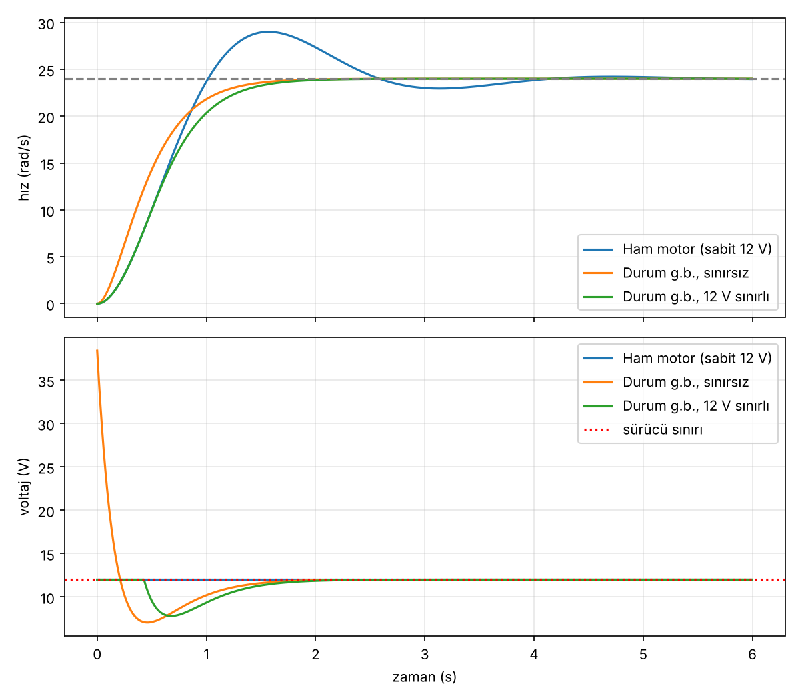
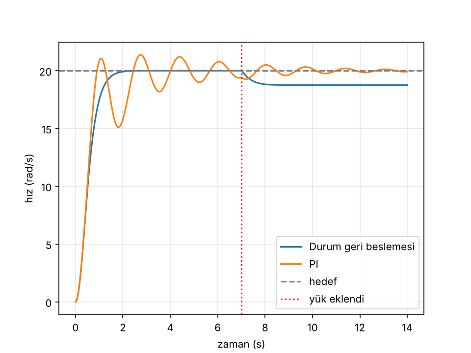

# DC Motor Speed Control: PI vs State Feedback

## What is this?
This project simulates the speed control of a DC motor and compares two controllers: a PI controller and a state-feedback controller designed by eigenvalue placement. It investigates how the choice of eigenvalues shapes the transient response (overshoot and settling time), how a controller without integral action responds to a constant load, and what happens when the voltage saturates at a 12 V driver limit. I built it to learn control theory from first principles as a foundation for robotics and ROS 2.

## The motor model
The state vector is chosen as `[i, ω]` (current and angular velocity) because these two variables capture the energy stored in the motor's inductance and rotor inertia and determine its future evolution. With parameters `R = 1`, `L = 0.5`, `Ke = Kt = 0.5` and `J = 0.1` (viscous friction neglected), the dynamics are:

- electrical: `L·di/dt = V − R·i − Ke·ω`
- mechanical: `J·dω/dt = Kt·i`

Back-EMF (`Ke·ω`) couples the two domains by opposing the applied voltage as speed rises. In steady state it balances the supply, so a constant 12 V settles at ω = V/Ke = 24 rad/s instead of accelerating indefinitely. In state-space form, `ẋ = A·x + B·V` with `A = [[−2, −1], [5, 0]]` and `B = [2, 0]ᵀ`.

The open-loop eigenvalues are `−1 ± 2i`: the negative real part guarantees stability, the imaginary part produces an underdamped response (overshoot), and the real part of −1 gives a time constant of 1 s, so the motor settles in roughly 4 s.

## Experiments and results

### Experiment 1: raw motor vs state feedback (target 24 rad/s)


Under a constant 12 V input with no load, the raw motor peaks at 29.0 rad/s (about 21% overshoot), matching the prediction from its `−1 ± 2i` eigenvalues. Placing the state-feedback eigenvalues at −4, −4 removes the overshoot and settles in about 1.5 s in the unconstrained case, but it asks for 38.4 V at start-up. With the voltage clamped at 12 V, the response stays overshoot-free and settles in 1.63 s.

### Experiment 2: load disturbance (target 20 rad/s, load at t = 7 s)


When a constant load is applied at t = 7 s, state feedback without integral action settles at 18.75 rad/s, a steady-state error of 1.25 rad/s, because it has no memory of past error. The PI controller recovers to 20 rad/s, but it is slower and overshoots by about 7% on the initial step.

## What I learned
- **Eigenvalues predict behavior before simulation.** The eigenvalues gave peak-speed estimates of 29 rad/s for the raw motor and 24 rad/s for the −4, −4 design; the simulation gave 29.0 and 24.0 rad/s.
- **Fast dynamics carry an actuator cost.** Placing the closed-loop eigenvalues at −4, −4 gave an overshoot-free response, but the controller asked for 38.4 V at start-up, more than three times the 12 V driver limit. Eigenvalue placement has to be checked against actuator limits.
- **No single controller wins everywhere.** State feedback without integral action settled at 18.75 rad/s under load, while PI recovered to 20 rad/s but overshot by about 7% on the initial step. Combining state feedback with integral action and anti-windup is the natural next step.

## How to run
Requirements: Python 3 and `matplotlib`.

```bash
pip install matplotlib
python test_motor.py   # expected: peak 29.01, final 24.01
python deneyler.py     # generates deney_ham_vs_sgb.png and deney_yuk.png
```

File and variable names are in Turkish (deney = experiment, kontrolcü = controller, hız = speed).

```
motor_kontrol/
├── motor.py            # DC motor model (Euler integration)
├── kontrolculer.py     # PID (saturation, anti-windup, filtered D) and state feedback
├── deneyler.py         # experiments and plots
├── test_motor.py       # open-loop check against eigenvalue predictions
├── deney_ham_vs_sgb.png
└── deney_yuk.png
```
